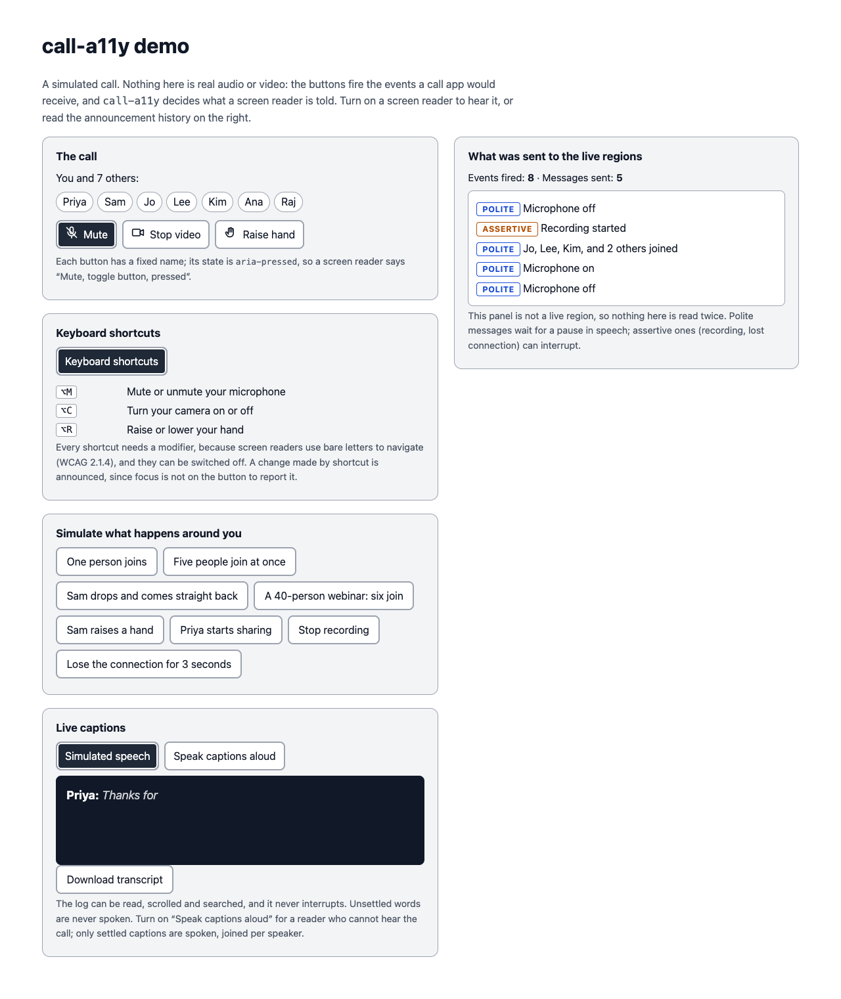

# call-a11y

Accessibility building blocks for real-time call UIs. It decides **what a screen reader is told during a call, and when**: joins batched into one line, recording and dropped connections announced at once, live captions that can be read without being shouted, and keyboard shortcuts that do not fight the screen reader.

Zero dependencies. Plain TypeScript for the core, optional React bindings. It sits on top of whatever call stack you use (LiveKit, Twilio, Daily, mediasoup, raw WebRTC): you tell it what happened, it handles the accessibility.



*The demo, in Chrome. Eight events were fired; five messages were sent. Five people joining at once became one line: "Jo, Lee, Kim, and 2 others joined".*

## Why

A video call is one of the harder things to make accessible. The main content is faces and voices, not text, and the state changes every few seconds: people join and leave, the network wobbles, someone starts recording. A sighted user takes that in at a glance; a screen reader user gets only what the interface chooses to say.

The usual failures are small and common: a mute button announced as just "button", a join banner nobody hears, thirty join announcements in a row, a bare-letter shortcut that fires when someone only wanted to move around the page. I wrote them up, with what fixes each, in [What a screen reader user hears in your video call](https://chasgharali.com/writing/accessible-video-calls). This package is that advice as tested code.

## Install

```sh
npm install call-a11y
```

React bindings need React 18 or newer (an optional peer dependency; the test suite passes on 18.3.1 and 19); the core needs only a DOM. Works with ESM and CommonJS. Import `call-a11y/styles.css` if you want the optional styles for the React components.

Size, minified and gzipped: the core is about 4.3 KB; the React entry, which includes the core, about 5.7 KB (React excluded).

## Use it without a framework

```ts
import { createAnnouncer, createCallAnnouncer } from 'call-a11y'

// Create once, when the call screen loads. The live regions must exist before
// the first message, so do not create it at the moment you first need it.
const announcer = createAnnouncer()
const call = createCallAnnouncer(announcer)

// Event names are illustrative: use whatever your SDK emits.
room.on('participantJoined', (p) => call.participantJoined(p.name))
room.on('participantLeft', (p) => call.participantLeft(p.name))
room.on('reconnecting', () => call.connectionChanged('reconnecting'))
room.on('reconnected', () => call.connectionChanged('connected'))
room.on('recordingStarted', () => call.recordingChanged(true))
```

## Use it with React

```tsx
import { useState } from 'react'
import {
  AnnouncerProvider,
  CaptionLogView,
  ToggleButton,
  useCallAnnouncer,
  useCaptionLog,
  useShortcuts,
} from 'call-a11y/react'
import 'call-a11y/styles.css' // optional

export function App() {
  return (
    <AnnouncerProvider>
      <Call />
    </AnnouncerProvider>
  )
}

function Call() {
  const call = useCallAnnouncer()
  const captions = useCaptionLog()
  const [muted, setMuted] = useState(false)

  const changeMuted = (next: boolean, source: 'control' | 'shortcut') => {
    setMuted(next)
    call.microphoneChanged(!next, source) // "Microphone off"
  }

  useShortcuts({
    'Alt+M': { description: 'Mute or unmute', handler: () => changeMuted(!muted, 'shortcut') },
  })

  // From your speech-to-text engine:
  //   captions.push({ id, text, final, speaker, speakerId })

  return (
    <>
      {/* The name stays "Mute"; the state is aria-pressed. */}
      <ToggleButton label="Mute" showLabel pressed={muted} onPressedChange={(next) => changeMuted(next, 'control')} />
      <CaptionLogView log={captions} />
    </>
  )
}
```

Run the demo yourself: `npm install && npm run demo`.

## What is in it

### `createAnnouncer(options?)`

Two persistent, visually hidden live regions, one polite (`role="status"`) and one assertive (`role="alert"`), and a queue in front of them.

| Behaviour | Why |
|---|---|
| Both regions are created up front, and the first message waits `readyMs` (100 ms) | A region that is created and filled in the same moment is often not announced |
| Messages in a region are spaced by `minGapMs` (400 ms) | Rapid updates to one region can cut each other off |
| `announce(message, { key })`: a queued message with the same key is replaced | Only the latest microphone state matters; a flurry of toggles should not become a backlog |
| The same words queued twice are said once; the queue is capped (`maxQueue`, 5) and drops the oldest | A backlog minutes behind the call is worse than a gap |
| Each message is a fresh element, and is removed after `clearAfterMs` (8 s) | A repeat is still a DOM addition, and stale text should not be found later by browsing |
| `onAnnounce(message, politeness)` | For a visible log, for tests, and for showing developers what the reader is told |
| `container` | See *Modal dialogs* below |

### `createCallAnnouncer(target, options?)`

Turns call events into announcements. `target` is any `{ announce(message, options) }`, normally the announcer above.

| Method | What is said | How |
|---|---|---|
| `participantJoined(name)` / `participantLeft(name)` | "Sam and Priya joined", "Sam, Priya, Jo, and 2 others joined" | Collected over `batchMs` (1200 ms) and said once. A leave followed by a rejoin inside the window, or a join then a leave, says nothing. |
| `setParticipantCount(n)` | | At `largeCallThreshold` (20) and above, names are dropped: "5 people joined, 41 in the call", over `largeBatchMs` (5 s) |
| `handRaised(name)` | "Sam raised a hand" | Batched like joins |
| `microphoneChanged(on, source?)`, `cameraChanged(on, source?)` | "Microphone off" | Polite, keyed so a rapid flip replaces a waiting message |
| `screenShareChanged(on, who?)` | "Priya started sharing their screen" | Polite |
| `recordingChanged(on)` | "Recording started" | **Assertive** on start: recording is a consent question, so it should be heard now |
| `connectionChanged(state)` | "Reconnecting", "Disconnected from the call" | **Assertive** for `reconnecting` and `disconnected`, polite for `connected` |
| `say(message, politeness?)` | anything | Escape hatch |

Active-speaker changes are deliberately not announced. In a lively call the speaker changes every few seconds, and announcing each change buries everything else. Offer it on demand, in a participant list or through a shortcut.

**`source`** says where a microphone or camera change came from: `control` (the toggle button was pressed), `shortcut`, or `remote` (someone else changed it). By default all are announced. When the user presses the toggle button itself, the screen reader also reports the button's new `aria-pressed` state, so the same fact can be said twice. Behaviour differs between screen readers and I have not tested them all, so the default errs towards saying it twice rather than not at all; set `controlChanges: 'skip'` if your own testing shows doubling.

**Wording.** Every sentence can be replaced through `messages`, and name lists are built with `Intl.ListFormat` in the `locale` you give. The defaults are English.

```ts
createCallAnnouncer(announcer, {
  locale: 'de',
  messages: { joined: (names, others) => `${names.join(', ')} ${others ? `und ${others} weitere ` : ''}beigetreten` },
})
```

### `createCaptionLog(options?)`

A model for live captions from a streaming speech recogniser. Give every version of one utterance the same `id`, with `final: false` until it settles.

- Unsettled results replace one another by `id`; settled ones commit. Consecutive utterances by one speaker within `mergeWithinMs` (4 s) read as one paragraph. Memory is bounded (`maxSegments`, 500).
- **Unsettled text is never spoken.** It changes too fast to be read aloud.
- Settled captions are spoken only if you ask (`announce: 'final'`), batched per speaker, through the announcer you pass. Default is `off`: most screen reader users can hear the call, and a second voice reading the captions on top of it is noise. `final` is for a reader who cannot hear it, such as a deaf-blind user on a braille display. `skipSpeakerId` keeps your own speech from being read back to you.
- `toText({ timestamps })` gives a plain transcript of the settled text.
- `subscribe` and `getSnapshot` make it usable with `useSyncExternalStore`, or with any framework.

### `createShortcuts(options)`

Global shortcuts that respect the screen reader.

- **A binding must include Ctrl, Alt or Meta**, or creating it throws with an explanation. NVDA and JAWS use bare letters to navigate, and WCAG 2.1.4 (Character Key Shortcuts) asks that a character-only shortcut can be turned off, remapped, or works only on focus. `allowCharacterKeys: true` opts out, and then you must offer a way to switch shortcuts off (`setEnabled(false)`).
- Ignores key repeat, input-method composition and AltGr (many Windows layouts report AltGr as Ctrl+Alt and use it to type). Bare-key shortcuts do not fire while the user types in a field; modifier shortcuts still do, as call apps expect for mute.
- Matches on the key's value, and for Alt or Shift combinations also on the physical key, so `Alt+M` works on a Mac (where Option+M types "µ") and on non-Latin layouts.
- `list()` returns the shortcuts with platform labels (`⌘D` or `Ctrl+D`) for a help dialog. `Mod` means Command on a Mac and Ctrl elsewhere.
- Avoid Ctrl+Alt combinations, and avoid combinations your browser or screen reader already uses.

### React

| Export | |
|---|---|
| `AnnouncerProvider` | Creates the live regions after mount (nothing touches the DOM during server rendering) and holds messages sent before they exist. Options are read once. Safe under StrictMode. |
| `useCallAnnouncer(options?)`, `useAnnouncer()` | `useCallAnnouncer` speaks through the nearest provider |
| `useCaptionLog(options?)`, `CaptionLogView` | See below |
| `ToggleButton` | A real `<button type="button">` with a fixed accessible name and `aria-pressed`. A decorative `icon` is hidden from assistive technology. With `showLabel`, the visible text is the name, so words and name match (WCAG 2.5.3). |
| `useShortcuts(bindings, options?)` | Registers while mounted; handlers can close over current state; returns the list for a help dialog |

`CaptionLogView` renders `role="log"` with `aria-live="off"` (a screen reader user can browse the captions but is not interrupted), focusable so keyboard users can scroll it. It follows the newest caption, and **stops following while the reader has scrolled up or has focus inside it**, with a button to resume, so text does not move under someone who is reading it (WCAG 2.2.2). Scrolling is instant, never animated. `data-call-a11y-*` attributes mark turns, speakers and unsettled text for your own styling.

`call-a11y/styles.css` is optional. It sets 44 px targets (WCAG 2.5.8 asks for 24), a 3 px focus ring, an inner ring on pressed buttons so the state does not rest on colour alone, a solid backing for captions, and forced-colours support. Everything is a custom property (`--call-a11y-*`).

## Design rules it follows

| Rule | Where | WCAG |
|---|---|---|
| A control's name does not change with its state; state is `aria-pressed` | `ToggleButton` | 4.1.2 Name, Role, Value |
| Status changes are exposed to assistive technology without moving focus | `createAnnouncer` | 4.1.3 Status Messages |
| Character-key shortcuts need a modifier, or can be turned off | `createShortcuts` | 2.1.4 Character Key Shortcuts |
| Auto-updating text can be paused | `CaptionLogView` | 2.2.2 Pause, Stop, Hide |
| Visible label and accessible name match | `ToggleButton showLabel` | 2.5.3 Label in Name |
| Targets are large enough | `styles.css` | 2.5.8 Target Size (Minimum) |

## What is tested, and what is not

- **129 unit tests** (jsdom + Testing Library) cover every behaviour above, including React StrictMode, server-safety and axe-core runs on the rendered components.
- **13 checks in real Chrome** (`npm run demo:build && npm run e2e`) drive the demo, read Chrome's own accessibility tree over the DevTools protocol (button names and pressed state, live-region politeness, and what a modal dialog removes from it) and run axe-core with colour contrast in light and dark colour schemes. They need Chrome installed.
- **Not tested: any real screen reader.** Nothing here has been run with JAWS, NVDA, VoiceOver or TalkBack, and nothing has been run in Firefox or Safari. The tests prove the DOM and ARIA mechanism; they cannot prove what a given screen reader then says. The timings (100 ms, 400 ms, 1.2 s) are reasonable heuristics, not measured constants. This is the most useful thing you can help with: see [docs/screen-reader-testing.md](docs/screen-reader-testing.md).
- "Accessibility-aware", not "certified": this is a set of building blocks, not a conformance claim about your product.

## Limits and gotchas

- **Modal dialogs.** `showModal()` makes everything outside the dialog inert. In Chrome's accessibility tree, an open modal removes the live regions outside it (the e2e checks this), so nothing in them can be announced. While a modal is open, create a second announcer with `container` set to the dialog.
- **React options are read once**, on the first render (`useCallAnnouncer`, `useCaptionLog`, `AnnouncerProvider`).
- **It is not a call SDK.** It has no media, signalling or speech recognition; it takes events and text from yours.
- `createAnnouncer` and `createShortcuts` need a DOM and throw a clear error without one. In React they are created in effects, so server rendering is safe.
- TypeScript resolves `call-a11y/react` with `moduleResolution` `node16`, `nodenext` or `bundler`; a `typesVersions` entry covers the older `node` setting.

## How it compares

Generic announcers such as [`@react-aria/live-announcer`](https://www.npmjs.com/package/@react-aria/live-announcer) (its public API is `announce`, `clearAnnouncer` and `destroyAnnouncer`) are a good fit for saying one message. `call-a11y` is a layer above: it decides what to say for participants, recording, connection and captions, batches and cancels, and adds the caption log and shortcut rules. When I searched npm on 2026-09-26 for call or WebRTC accessibility packages I found none; that is a snapshot, not a claim.

## Development

```sh
npm install
npm run check          # typecheck, tests, build, package lint
npm run demo           # the demo, with hot reload
npm run demo:build && npm run e2e   # the real-Chrome checks
```

## Licence

MIT © Asghar Ali
